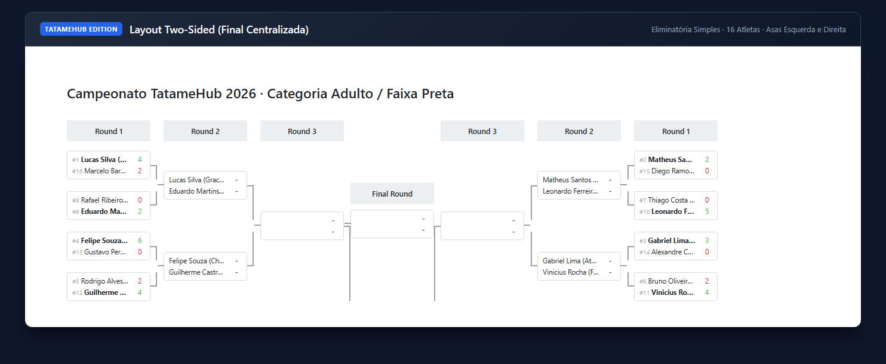

# @brunomroque/brackets-viewer-tatamehubedition · TatameHub Edition

<p align="center">
  <a href="https://github.com/Drarig29/brackets-viewer.js"></a>
  <a href="LICENSE"></a>
  <a href="https://www.npmjs.com/package/@brunomroque/brackets-viewer-tatamehubedition"></a>
  <a href="https://github.com/sponsors/brunomroque"></a>
  <a href="https://ko-fi.com/brunomroque"></a>
</p>

<p align="center">
  <a href="#-contexto-por-que-este-fork-existe"><b>🥋 Contexto</b></a> &bull;
  <a href="#-exemplo-layout-two-sided-side-by-side"><b>📸 Exemplo</b></a> &bull;
  <a href="#-o-que-há-de-novo-na-tatamehub-edition"><b>✨ Novidades</b></a> &bull;
  <a href="#-como-usar"><b>🚀 Como Usar</b></a> &bull;
  <a href="#%EF%B8%8F-demos-dispon%C3%ADveis"><b>🖥️ Demos</b></a> &bull;
  <a href="#-apoie-o-projeto--sponsoring--donations"><b>💖 Apoiar</b></a> &bull;
  <a href="#-créditos-e-reconhecimento"><b>🤝 Créditos</b></a>
</p>

> **Fork estendido de [brackets-viewer.js](https://github.com/Drarig29/brackets-viewer.js)** (criado originalmente por [Corentin Girard / Drarig29](https://github.com/Drarig29)), desenvolvido sob medida para a plataforma **[TatameHub](https://github.com/brunomroque/brackets-viewer-tatamehubedition)** e competições de artes marciais (Jiu-Jitsu, Judô, Karatê, Taekwondo, etc.).

---

## 🥋 Contexto: Por que este Fork existe?

Nas artes marciais e esportes de combate, o chaveamento tradicional de eliminatória simples não segue o formato linear horizontal (da esquerda para a direita) comum em torneios de videogame e eSports. 

Em campeonatos oficiais (como IBJJF, CBJJ, IJF):
1. **Chaves "Two-Sided" (Side by Side / Final no Centro):** Os atletas são divididos em duas alas simétricas — **Ala Esquerda (Pools A/B)** e **Ala Direita (Pools C/D)** — que avançam em direção ao meio, culminando com a **Grande Final centralizada**.
2. **Impressão em Cartazes e Folhas A4:** Torneios presenciais de tatame dependem de impressão física das chaves para afixação em painéis e mesas de arbitragem. Uma chave de 32, 64 ou 128 atletas não cabe legível em uma única folha A4 e precisa ser fracionada de forma matemática em blocos de 16 atletas por página, mantendo conectores visuais (*stubs*) e divisões oficiais de repescagem.

Como o `brackets-viewer.js` original suportava apenas o modelo linear, criamos esta edição para suportar de forma nativa e robusta essas demandas de tatame, mantendo **100% de retrocompatibilidade** com a API original.

---

## 📸 Exemplo: Layout Two-Sided (Side by Side)

Abaixo, um exemplo real gerado com a nova opção `layout: 'two-sided'`, mostrando o chaveamento de 16 competidores com as chaves laterais convergindo para o centro:



---

## ✨ O que há de novo na TatameHub Edition?

### 1. Layout `two-sided` (Final Centralizada)
- **Alas Simétricas:** Distribui as rodadas automaticamente em duas asas espelhadas (`left-wing` e `right-wing`) com a final no centro.
- **Escala de 8 a 256 Atletas:** Testado e otimizado para chaves de 8, 16, 32, 64, 128 e até 256 atletas.
- **Tratamento Seguro de Byes:** Algoritmo null-safe que preserva o equilíbrio das alas mesmo em chaves incompletas com isenções de primeira rodada (*byes*), como chaves de 42 ou 58 competidores.
- **API Aditiva:** Não quebra projetos existentes. Se o parâmetro `layout` for omitido, o comportamento padrão continua sendo `layout: 'linear'`.

### 2. Módulo de Paginação e Impressão A4 (`planEliminationPrintPages`)
- **Divisão Inteligente:** Fragmenta chaves grandes em folhas A4 padronizadas com 16 atletas por página:
  - 16 atletas → 1 folha
  - 32 atletas → 2 folhas
  - 64 atletas → 4 folhas
  - 128 atletas → 8 folhas
  - 256 atletas → 16 folhas
- **Stubs de Continuidade:** Cria marcadores de borda indicando para qual página e para qual confronto o vencedor avança.
- **Distribuição de Repescagem IJF:** Mapeamento automático dos grupos de repescagem (A/B e C/D) nas folhas correspondentes.

---

## 🚀 Como Usar

### Instalação

```bash
npm install @brunomroque/brackets-viewer-tatamehubedition
```

Ou incluindo via CDN:

```html
<link rel="stylesheet" href="https://cdn.jsdelivr.net/npm/@brunomroque/brackets-viewer-tatamehubedition@1.10.0/dist/brackets-viewer.min.css" />
<script type="text/javascript" src="https://cdn.jsdelivr.net/npm/@brunomroque/brackets-viewer-tatamehubedition@1.10.0/dist/brackets-viewer.min.js"></script>
```

### 1. Renderizando Chave Two-Sided

```js
// Carregue seus dados do torneio (compatível com brackets-manager ou brackets-model)
await window.bracketsViewer.render({
    stages: data.stage,
    matches: data.match,
    matchGames: data.match_game,
    participants: data.participant,
}, {
    selector: '#bracket-container',
    clear: true,
    layout: 'two-sided', // 👈 Ativa o layout com a final no centro
    participantOriginPlacement: 'before',
    showSlotsOrigin: true,
    highlightParticipantOnHover: true,
});
```

### 2. Calculando Páginas de Impressão A4

```js
import { planEliminationPrintPages } from '@brunomroque/brackets-viewer-tatamehubedition';

// Exemplo: torneio com 32 atletas
const pages = planEliminationPrintPages(16, 32);

console.log(pages);
// Retorna o plano de impressão com os confrontos divididos em 2 folhas A4
```

---

## 🖥️ Demos Disponíveis

Para testar localmente:

1. Clone o repositório:
   ```bash
   git clone https://github.com/brunomroque/brackets-viewer-tatamehubedition.git
   cd brackets-viewer-tatamehubedition
   ```
2. Abra os arquivos de demonstração no navegador:
   - [`demo/two-sided.html`](demo/two-sided.html) — Seletor interativo de 8 a 256 atletas no modo final centralizada.
   - [`demo/print-pagination.html`](demo/print-pagination.html) — Visualização das páginas A4 prontas para impressão e cartazes.
   - [`demo/index.html`](demo/index.html) — Catálogo com todas as demos (originais e novas).

---

## 💖 Apoie o Projeto / Sponsoring & Donations

Este projeto e suas adições (layout *two-sided* para tatame e paginação A4) são mantidos de forma independente sob a licença de código aberto MIT. Se esta ferramenta acelerou o seu evento, campeonato ou projeto comercial, **considere apoiar a evolução contínua da ferramenta!**

### 🇧🇷 Brasil & Pix
Você pode enviar qualquer valor diretamente via **Pix** utilizando a chave aleatória abaixo:

```text
6273ae2e-7345-405b-873c-6749946c8488
```

### 🌍 Apoio Internacional (Global)
<p>
  <a href="https://buymeacoffee.com/brunomroque">
    
  </a>
  &nbsp;
  <a href="https://ko-fi.com/brunomroque">
    
  </a>
  &nbsp;
  <a href="https://github.com/sponsors/brunomroque">
    
  </a>
</p>

---

## 🤝 Créditos e Reconhecimento

Este projeto é um fork construído a partir do excelente trabalho de:

- **Corentin Girard ([@Drarig29](https://github.com/Drarig29))** — Criador original do [brackets-viewer.js](https://github.com/Drarig29/brackets-viewer.js) e do ecossistema [brackets-manager.js](https://github.com/Drarig29/brackets-manager.js).
- **[Nantarena](https://nantarena.net/)** — Projeto para o qual a biblioteca original foi concebida.

As adições do **TatameHub** (layout `two-sided`, correções de byes e planejamento de impressão A4) foram desenvolvidas para suprir as necessidades de eventos esportivos e de artes marciais, mantendo a licença **MIT** e total respeito à arquitetura original. Consulte o arquivo [NOTICE](NOTICE) e [LICENSE](LICENSE) para mais detalhes.

---

Desenvolvido com carinho por [Bruno Roque](https://github.com/brunomroque) & Colaboradores do TatameHub.
